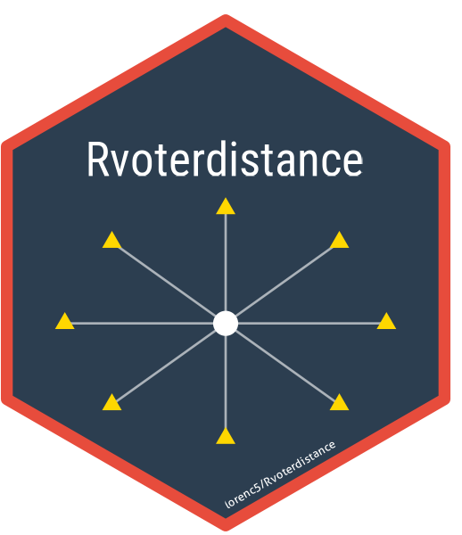

# Rvoterdistance 

[](https://github.com/RPVote/Rvoterdistance/actions?workflow=R-CMD-check)
[](https://github.com/RPVote/Rvoterdistance/actions?workflow=Styler)

Calculates the geographic distance between voters in a voter file and multiple polling or vote-by-mail drop box locations using the Haversine (great-circle) formula. Core computation is implemented in C++ via Rcpp for speed.

## Features

- **Nearest location**: find the single closest polling place for each voter
- **k-nearest locations**: find the k closest locations per voter
- **Distance threshold**: find all locations within a specified radius (e.g., all drop boxes within 5 miles)
- **sf integration**: pass `sf` POINT geometries directly with automatic CRS transformation to WGS-84
- **Progress reporting**: optional progress output for large voter files
- **Units**: results in meters, kilometers, and miles
- **Road-network routing**: driving, walking, and cycling distances and travel times via optional `dodgr` and `cppRouting` backends

## Installation

```r
# From GitHub:
remotes::install_github("lorenc5/Rvoterdistance")
# or
remotes::install_github("RPVote/Rvoterdistance")
```

## Quick Start

```r
library(Rvoterdistance)
data(meck_ev)

# Nearest early voting location for each voter
result <- nearest_location(voter_meck, early_meck,
  voter_coords = c("lat", "long"),
  location_coords = c("lat", "long"))
head(result)

# 3 nearest locations per voter
result_k3 <- nearest_location(voter_meck, early_meck,
  voter_coords = c("lat", "long"),
  location_coords = c("lat", "long"),
  k = 3)

# All locations within 5 miles
result_5mi <- nearest_location(voter_meck, early_meck,
  voter_coords = c("lat", "long"),
  location_coords = c("lat", "long"),
  max_dist = 5, units = "miles")
```

## Main Functions

| Function | Description |
|---|---|
| `nearest_location()` | Main entry point. Supports k-nearest, distance threshold, sf objects, and road-network routing. |
| `prepare_network()` | Download and cache a road network for repeated routing calls. Accepts Overpass API bbox or a local OSM file. |
| `download_osm()` | Download a Geofabrik/BBBike OSM extract for a state or region. |
| `dist_km()` | Minimum distance to nearest location in kilometers. |
| `dist_mile()` | Minimum distance to nearest location in miles. |
| `haversine()` | Single-pair great-circle distance with configurable units. |

## Using sf Objects

```r
library(sf)
voters_sf <- st_as_sf(voter_meck, coords = c("long", "lat"), crs = 4326)
locs_sf   <- st_as_sf(early_meck, coords = c("long", "lat"), crs = 4326)

result <- nearest_location(voters_sf, locs_sf)
```

If the CRS is not WGS-84 (EPSG:4326), coordinates are automatically transformed.

## Road-Network Routing

For realistic driving, walking, or cycling distances and travel times, install the optional `dodgr` package (and optionally `cppRouting` for faster computation on large datasets):

```r
install.packages("dodgr")
install.packages("cppRouting") # optional, for speed
```

Then use the `method` parameter. **Note:** calling `nearest_location()` with a road-network method but without a pre-built network will download the street network from OpenStreetMap and build a routing graph on every call, which can be slow. For quick one-off exploration this is fine, but for any repeated use, build the network once with `prepare_network()` as shown below.

```r
# Driving distance (slow first call -- downloads street network)
result <- nearest_location(voter_meck[1:10, ], early_meck,
  voter_coords = c("lat", "long"),
  location_coords = c("lat", "long"),
  method = "driving")

# Walking travel time (also slow without a cached network)
result_time <- nearest_location(voter_meck[1:10, ], early_meck,
  voter_coords = c("lat", "long"),
  location_coords = c("lat", "long"),
  method = "walking", measure = "time")
```

**Recommended workflow:** use `prepare_network()` to download and build the routing graph once. This is the slow step (network download + contraction hierarchy construction), but you only need to do it once. All subsequent `nearest_location()` calls that pass the network object are fast.

```r
# Build once (slow -- downloads OSM data and builds routing graph)
net <- prepare_network(
  voters = voter_meck, locations = early_meck,
  voter_coords = c("lat", "long"),
  location_coords = c("lat", "long"),
  mode = "driving")

# All subsequent calls are fast
result1 <- nearest_location(voter_meck[1:100, ], early_meck,
  voter_coords = c("lat", "long"),
  location_coords = c("lat", "long"),
  method = "driving", network = net)

result2 <- nearest_location(voter_meck, early_meck,
  voter_coords = c("lat", "long"),
  location_coords = c("lat", "long"),
  method = "driving", network = net)

# Save network to disk so you never need to download again
saveRDS(net, "meck_driving_network.rds")

# In a later session:
net <- readRDS("meck_driving_network.rds")
```

### Large-area routing (state/country level)

For state-sized or larger areas, the Overpass API is too slow. Use `download_osm()` to get a pre-built extract from [Geofabrik](https://download.geofabrik.de/), then build the network from the local file. Requires the `osmextract` package:

```r
install.packages("osmextract")

# Download Georgia (US) extract (~320 MB, cached for reuse)
# Note: use "Georgia, United States" to avoid matching the country Georgia
osm_file <- download_osm("Georgia, United States")

# Build network from local file (skips Overpass entirely)
net <- prepare_network(file = osm_file, mode = "driving")
saveRDS(net, "georgia_driving.rds")

# Route as usual
result <- nearest_location(georgia_voters, dropboxes,
  voter_coords = c("lat", "lon"),
  location_coords = c("lat", "lon"),
  method = "driving", network = net)
```

## Included Data

- **king_dbox / king_geo**: King County, WA ballot drop box locations and voter sample
- **meck_ev (voter_meck / early_meck)**: Mecklenburg County, NC early voting locations and voter sample
- **ga_ev (ga_voter / ga_dbox)**: Georgia 2020 drop box locations (307 statewide) and voter sample (400 voters from Chatham, Clarke, Fulton, Muscogee counties)

## Citation

Collingwood, Loren. 2026. *Rvoterdistance: Voter Distance to Polling Locations*. R package version 2.0.0. https://github.com/lorenc5/Rvoterdistance

## License

GPL (>= 2)
